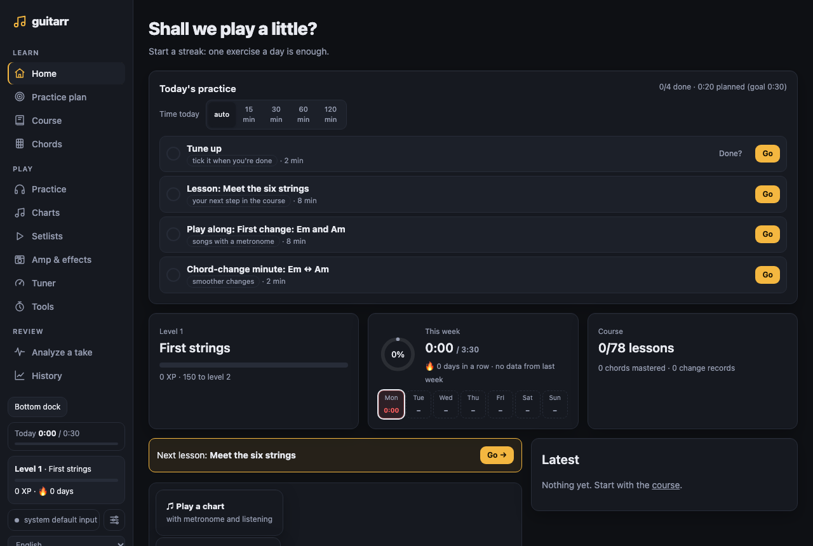
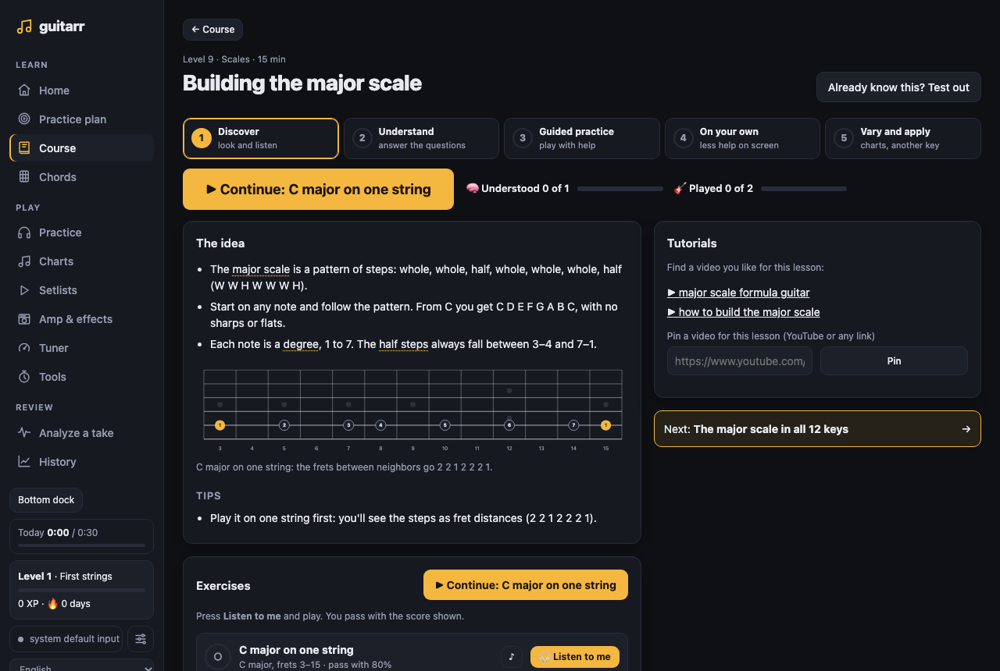
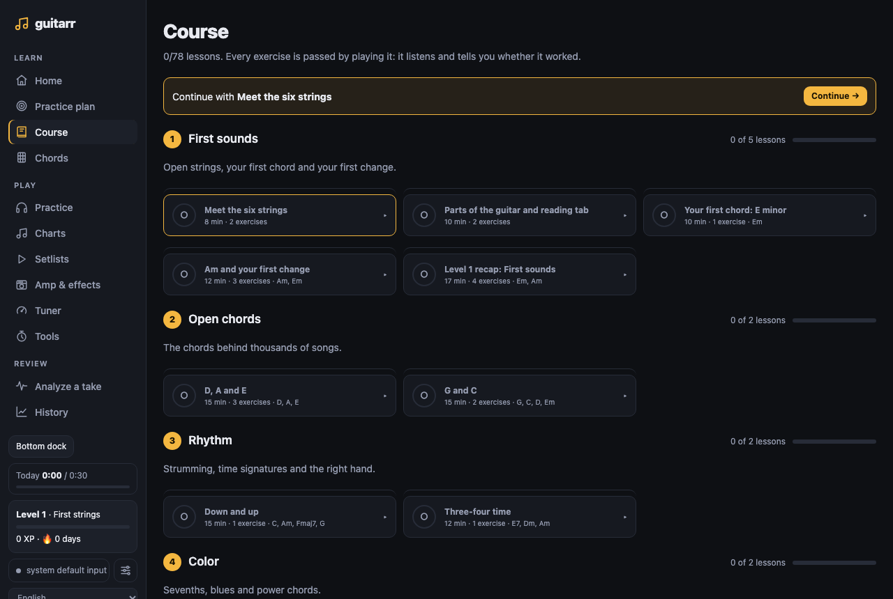
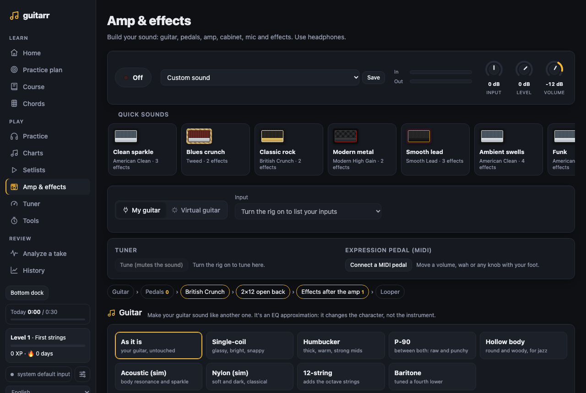
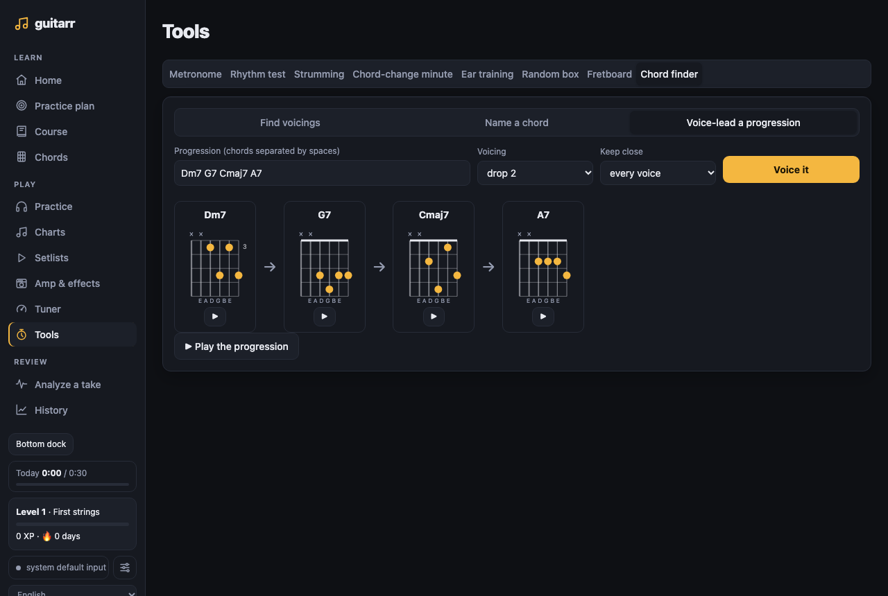
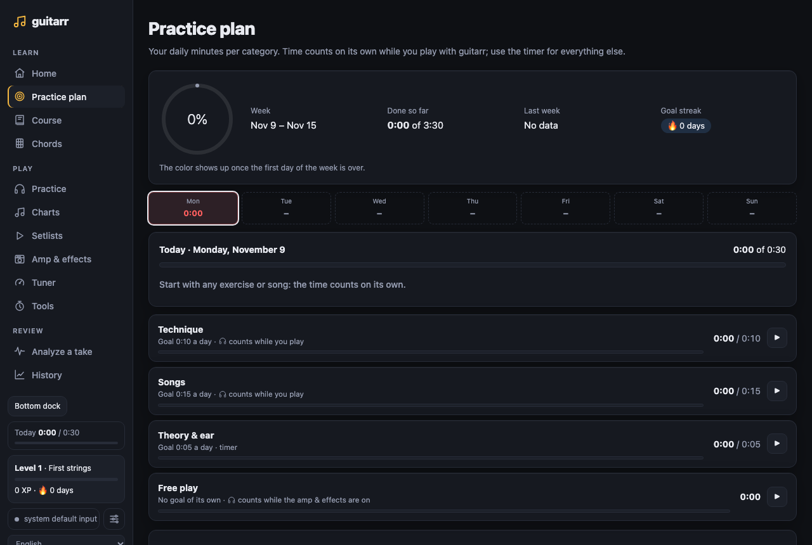

# guitarr

**A guitar practice companion that listens to you.** Plug your guitar into your computer and
guitarr tells you which note or chord you missed, which one you skipped, what you played
extra and where you drifted out of time — live, while you play, or afterwards from a
recording.

Everything you learn is *passed by playing*: lessons, chord checks and drills are graded by
what the listener actually heard (and, optionally, by a camera that checks your fingering).

It runs two ways:

- **On your computer** (one person, your audio interface): `make install`, then `make run` → http://127.0.0.1:8765
- **As a web service** (accounts, Postgres, the guitar captured by the browser): `cp .env.example .env`, then
  `make up` → http://localhost:8765. With a domain, `make up HTTPS=1` puts it on the internet with https.

`make` lists every command.

---

## Contents

- [Screenshots](#screenshots)
- [Features](#features)
- [Requirements](#requirements)
- [Installation](#installation)
- [The web service (several users)](#the-web-service-several-users)
- [Quick start](#quick-start)
- [The web UI](#the-web-ui)
- [Command line](#command-line)
- [Practicing with your guitar](#practicing-with-your-guitar)
- [References: what you play against](#references-what-you-play-against)
- [Chord charts](#chord-charts)
- [Course, chords and progress](#course-chords-and-progress)
- [Languages](#languages)
- [How it works](#how-it-works)
- [Accuracy and limitations](#accuracy-and-limitations)
- [Data and files](#data-and-files)
- [Development](#development)
- [Third-party software](#third-party-software)

## Screenshots

| | |
|---|---|
|  |  |
|  |  |
|  |  |

Light-theme versions are in [docs/screenshots](docs/screenshots). They're generated, not hand-made:
`.venv/bin/python scripts/screenshots.py` boots the app with a temporary data folder and demo data and
retakes them in both themes.

## Features

**Play**
- **Live practice** with a scrolling tablature, input meter and tuning readout.
  - *Wait mode*: waits until you play each note or chord right.
  - *Tempo mode*: metronome with count-in; judges both note and timing.
- **Speed trainer**: loop a section; the tempo goes up after every clean pass and down after a bad one.
- **Chord charts**: chords per bar, played with a metronome. Filler strums don't count as mistakes, and a capo is handled for you (tab and chord names stay relative to the capo). Write your own in a simple text format.
- **Legato detection**: hammer-ons, pull-offs and slides are caught even without a pick attack.
- **Bends and vibrato**: each held bend says how many cents sharp or flat it landed, and a vibrato on it is measured (width in cents, speed in Hz).

**Learn**
- **Course**: 23 levels, 134 lessons and 336 exercises, from open strings to barre chords, fingerpicking and arpeggios, the blues, reading, scales, harmony and jazz. Every exercise is passed by playing it, and nothing is used before a lesson teaches it (a test checks the order). Each exercise has a short theory note (📖) that 🔊 reads aloud. The listener hears notes played together too: pinches in fingerpicking and double stops. Each level recap asks what the 📖 notes said (a sentence with a glossary word left out).
- **Optional courses**: a heavy-metal course in 3 levels (12 lessons, 28 exercises): the chug and the gallop, pedal-point riffs, dark intervals, the scales of metal, sequences, tremolo picking, bends and harmonics, twin-guitar harmony and a full piece. Three more, 3 levels each: **flamenco** (14 lessons, 32 exercises: the Andalusian cadence, rasgueo, golpe and apagado, rumba, the harmony of the flamenco mode, por arriba and por medio, tangos, the Phrygian and Phrygian dominant scales, picado, falsetas, the 12-beat compás, alegrías, the palos and their compás, and a full piece), **rock** (9 lessons, 19 exercises: the boogie, power-chord riffs, accents and stops, pentatonic boxes, the blue note, classic licks and bends, call-and-response phrasing, double stops and a full song) and **tango** (9 lessons, 17 exercises: marcato, síncopa, minor-key harmony, milonga, bass lines and bordoneo, harmonic-minor melodies, the chan-chan ending and a full tango). Four intro levels too: **funk** (sixteenth-note strumming, small chords and stabs, single-note riffs), **bossa nova** (the thumb-and-syncopation rhythm, seventh chords, the ii–V–I, a full song), **country** (boom-chick, the major pentatonic and twangy hammer-ons, a song) and **fingerstyle** (an independent thumb, percussive slaps, an Am–F–C–G groove). None of them counts toward the main course.
- **Find your level**: already play? Answer yes or no to one skill per level and the course continues from the first one you don't have yet. Nothing is marked as passed; each lesson still has its own check to skip it.
- **Tutorials**: each lesson suggests video searches, and you can pin your favorite video (YouTube links play inline).
- **Chord dictionary**: 43 chords with clickable diagrams. **Check** listens to you strum and tells you what was missing ("missing C# (major 3rd), extra C").
- **Camera**: hand tracking (MediaPipe, fully local) checks that each finger is on the right string and fret.
- **Improvise**: play anything over a backing (12-bar blues, a minor groove, a rock riff, pop, a Dorian vamp, a ii–V–I) with bass and drums. Every note is heard against the chord of the moment (chord tone, scale note, approach note or outside), and the report scores the solo and says what to work on: landing on chord tones, leaving space, using more of the neck.
- **Neck game**: a note and a string appear, you play it, the next one comes. How many in 30 or 60 seconds? Records per set of strings.
- **Listen slower**: a song's recording (or any audio file you open) at 50–100% speed without changing its pitch, with an A–B loop. On each song's page and in Tools.
- **Tools**: metronome with tap tempo; a **chord-change minute** that counts only the clean changes it heard and keeps your record per chord pair; a fretboard explorer with scales and arpeggios.

**Plan**
- **Practice plan**: daily minutes per category (technique, songs, theory and your own). Time counts on its own while you play with guitarr, counting only the time you're actually playing (long pauses are left out); a timer covers practice away from the app. See the week at a glance (each day green, yellow or red with its minutes), a weekly progress ring, last week's total and a streak of days that met their goal. Changing the plan applies from today on: days already gone keep their goal, and past weeks stay as they were.

**Sound**
- **Amp & effects**: a full virtual rig in the browser, with live monitoring through headphones. It covers guitar voicings (single-coil, humbucker, P-90, hollow, acoustic, nylon, 12-string, baritone), 17 pedals and effects, 9 amps, 8 cabinets with 4 microphone types (position, distance, room), your own cabinet IRs, a looper and 13 factory presets. Save your own presets too. A **virtual guitar** plays original riffs so you can try sounds without an instrument. **The right sound, one click away**: lessons, charts (a `tone:` header; the genre charts have one) and songs (chosen on the song's page) offer their rig sound when you practice them. **Match a recording's tone**: open a recording, play a few seconds, and the EQ moves your lows, mids and highs toward it (the balance, not the distortion). **Compare A/B**: store two sounds and switch between them instantly; the louder one is turned down to match, so you compare tone, not volume. A MIDI program change loads your favorite sounds in order. The rig keeps playing while you practice, and the listener always grades your clean signal.

**Review**
- **Take analysis**: transcribes a recording and aligns it with the reference, even at another tempo, then draws a piano roll of reference vs. what you played.
- **Groove**: where in the beat your timing slips (on the beat, the "and", sixteenths, triplets) and how even your attack is, including weak upstrokes.
- **History**: score over time per song, plus your weakest bars, with a one-click "practice these bars with the trainer". **Then and now** puts your first recorded take of a song next to your latest, to listen to both.
- **Progress**: XP, levels, a day streak and a feed of what you earned.
- **Teacher assignments**: share a setlist as a file with a note and your own charts inside; the student imports it on their Setlists page and sends back the weekly report. On the web service, **classes** do this without files: the teacher sees each student's week and sends setlists from the app.
- **Weekly report**: the last 7 days on one page (time per day and category, songs played and their scores, what you earned, your skills), to print or save as a PDF for yourself or a teacher. Plan → Weekly report.
- **Weekly challenges**: three small goals each week (practice on 5 days, plus two that rotate), +20 XP for each.
- **Your skills**: a radar on the home page with how far you got in each area (chords, rhythm, technique, the neck, scales, harmony, blues, jazz, ear), from the exercises you passed and what the tools measured.

## Requirements

- **Python 3.10 or 3.11** (basic-pitch doesn't support 3.12 yet), or **Docker** for the web service.
- **macOS** is the tested platform for the local app. Metronome/input sync relies on CoreAudio timestamps; on other systems, run `guitarr calibrate`. The web service takes the guitar from the browser, so any system with a modern browser works.
- An **audio interface or a USB guitar cable**. A plain microphone works for testing, but expect worse detection.
- A modern browser (Chrome, Safari, Firefox) for the web UI. The camera is optional.
- No Node.js: the web UI is served as plain ES modules by the Python server.

## Installation

```bash
make install                     # creates .venv and does all of the below (dev tools + Chromium for browser tests)
make run                         # the app in the background → http://127.0.0.1:8765 (make stop)
```

Or by hand:

```bash
python3.11 -m venv .venv
source .venv/bin/activate
pip install -e ".[dev]"          # installs the `guitarr` command and the test tools
pip install -e ".[separate]"     # optional: Demucs, to isolate the guitar from full mixes
guitarr gui                      # opens http://127.0.0.1:8765
```

Dependency versions are pinned in `pyproject.toml` and `requirements.txt`: basic-pitch, librosa and NumPy often break between releases.

**The `make` commands** (`make` alone lists them):

| | Local app | Web service in Docker | Web service outside Docker |
|---|---|---|---|
| Set up | `make install` | `cp .env.example .env` | `make install`, `make db-start` (only Postgres, on 127.0.0.1:5442) |
| Run | `make run` / `make stop` | `make up` / `make down` / `make restart` | `make run-service` (jobs included); `make worker` for more |
| Migrations | — | `make migrate`, `make db-status-docker` | `make db-migrate`, `make db-status`, `make db-new NAME=x` |
| Sign in | — | `make login EMAIL=you@example.com` | `make login-local EMAIL=you@example.com` |
| Look inside | `make test`, `make test-fast` | `make logs` (`S=worker`), `make ps`, `make psql`, `make backup` | `DATABASE_URL=...` for another Postgres |

`make up` takes `HTTPS=1` (https in front), `APPS=n` (app containers, with `HTTPS=1`) and `WORKERS=n`.

## The web service (several users)

```bash
cp .env.example .env             # settings (all optional on this machine)
make up                          # → http://localhost:8765   (docker compose up --build -d)
make login EMAIL=you@example.com # a sign-in link printed here: no mail server needed (new accounts are made)
make down                        # stop it; the data stays in the volumes
```

Docker Compose runs Postgres (`db`), the schema migrations (`migrate`, which runs once and exits), the app
(`guitarr`) and a worker for the slow jobs (`worker`); the app and the worker start only after the migrations
succeed. `GUITARR_PORT=8766` in `.env` moves it to another port (e.g. while the local app uses 8765).

- **Sign in** with your email: a one-time link, emailed (or printed to the log without a mail server; or made
  on the server with `make login EMAIL=...`, `make login-local` outside Docker). Opening
  the link shows whose account it is, and a button signs in; it warns when the link was asked for in another
  browser (someone could send you a link to their own account).
- **Audio:** your browser captures the guitar (the clean input, without the tone rig) and streams it to the
  server, which grades it. The metronome clicks (and a chart's bass & drums) play in the browser, so this works
  on macOS, Windows and Linux. The tuner, the signal check and the latency calibration use the browser's input
  too; a calibration is kept for that input (else the browser's own latency estimate is used). Browsers open
  the microphone only on `https://` or on `localhost`.
- **Data:** accounts, settings, progress, practice plan, setlists, history and your charts live in Postgres
  (`guitarr-db` volume). Each user's files (songs, takes, impulse responses) live in their own folder in the
  `guitarr-data` volume (`/data/users/<id>`). A backup (Settings → Your data) is the same zip as the local
  app's, so you can move your data between them.
- **Slow work runs as jobs.** Transcribing a recording you uploaded (basic-pitch, and Demucs when separating
  the guitar) and analyzing a take take from seconds to minutes, so the request only queues a job, the `worker`
  runs it and the page waits for it. Each user has `GUITARR_QUOTA_MB` (1000) of space for songs and takes and up
  to `GUITARR_JOBS_PER_USER` (3) jobs waiting.
- **Classes:** a teacher invites students with a link (Class → Invite students). A student who joins shares
  their weekly report with that teacher and gets the setlists the teacher sends, with a note and the teacher's
  own charts; either side can end it.
- **Admin:** the emails in `GUITARR_ADMINS` see accounts, space, practice this week and the jobs, and can block
  an account.

**Settings** (in `.env`; `.env.example` lists them all):

| Setting | What it's for |
|---|---|
| `POSTGRES_PASSWORD` | The database password, set before the first start (Postgres keeps the one it was created with) |
| `GUITARR_PORT` | The port on this machine without https (8765) |
| `GUITARR_PUBLIC_URL` | The address in sign-in and invitation links (with https: `https://GUITARR_DOMAIN`) |
| `GUITARR_SMTP_HOST`, `_PORT` (587), `_USER`, `_PASSWORD` | The mail server for sign-in links |
| `GUITARR_SMTP_TLS` | `starttls` (default), `ssl` (default on port 465) or `off` (a local mail catcher) |
| `GUITARR_MAIL_FROM` | The sender of sign-in emails |
| `GUITARR_QUOTA_MB`, `GUITARR_JOBS_PER_USER` | Space (1000 MB) and jobs waiting (3) per user |
| `GUITARR_ADMINS` | Emails that see the admin page (comma separated) |
| `GUITARR_DOMAIN`, `GUITARR_LB_SECRET` | With https: your domain, and the secret that signs the cookie keeping a browser on one app container |
| `GUITARR_DB_PORT` | Postgres on 127.0.0.1 for the web service outside Docker (5442) |

When the mail server fails, the sign-in page says so.

### Database migrations

Schema changes are numbered SQL files in `guitarr/db/migrations/`, applied in order and only once. `make up`
applies the pending ones before the app starts.

```bash
make db-new NAME=add_something        # creates the next NNNN_add_something.sql
make db-status-docker                 # what's applied and what's pending (outside Docker: make db-status)
make migrate                          # apply them now (outside Docker: make db-migrate)
```

Never edit a migration that already ran somewhere: write a new one (an edited file is refused).

### On the internet (https)

`compose.https.yaml` puts Caddy in front, which gets the certificate from Let's Encrypt for your domain. Point
the domain's DNS at the machine, open ports 80 and 443, and set `GUITARR_DOMAIN`, a real `POSTGRES_PASSWORD`,
`GUITARR_LB_SECRET`, the mail server and `GUITARR_ADMINS` in `.env`:

```bash
make up HTTPS=1 APPS=2 WORKERS=2
# = docker compose -f compose.yaml -f compose.https.yaml up --build -d --scale guitarr=2 --scale worker=2
```

Only Caddy is published. A browser stays on the app container it first reached (the `guitarr_app` cookie),
because a live practice session lives in that process; if that container stops, the next request goes to
another one and you stay signed in (a live session in progress is lost). To try it on this machine, use
`GUITARR_DOMAIN=localhost` (Caddy's own certificate: the browser warns once).

### Running it

- *Backups:* `make backup` dumps the database to a `.sql` file (and prints how to restore it). Users' files are
  in the `guitarr-data` volume; each user can also download their own backup.
- *Scaling:* add workers freely (`WORKERS=n`): they take jobs without stepping on each other. Without https keep
  one app container; behind Caddy you can run several (`APPS=n`).
- *Health:* `/api/health` answers 503 when the app can't reach the database (the container's health check uses
  it). Workers stop cleanly on `make down`, after the job at hand. Expired sign-in links, sessions and
  invitations are deleted by the workers.
- *Outside Docker* (to develop the service): `make db-start` starts only Postgres, then `make db-migrate` and
  `make run-service` (on `PORT`, 8765; users' files in `~/.guitarr-service`).

### Single user with the server's own audio input (Linux hosts)

Pass your ALSA devices through. This runs the app without accounts or the database:

```bash
docker compose -f compose.yaml -f compose.linux-audio.yaml up --build guitarr
```

The image runs basic-pitch's bundled ONNX model with onnxruntime, because its TensorFlow dependency on Linux conflicts with the pinned NumPy 2.x.

## Quick start

**Without a guitar** (to see how it works):

```bash
guitarr demo                                       # creates demo/ with planted mistakes
guitarr file demo/reference.mid demo/take.wav      # analyze the recorded take
guitarr live demo/reference.mid --simulate demo/take.wav --mode tempo --speed 0.9
```

In the web UI, **Practice → Load the demo** sets up the same thing.

**With your guitar:**

```bash
guitarr devices                          # list inputs; the likely interface is marked
guitarr config --device 3 --channel 1    # remember it
guitarr calibrate                        # measure the latency once (saved)
guitarr gui                              # and start practicing
```

## The web UI

`guitarr gui` opens a local web app (default http://127.0.0.1:8765; `--port`, `--host` and `--no-browser` are available).

| Section | What it does |
|---|---|
| **Home** | Level, XP, streak (this week at a glance), next lesson, weakest bars and recent activity |
| **Course** | Levels → lessons → exercises passed by playing; theory, tips, chord diagrams and tutorials |
| **Chords** | Dictionary by family; hear each string, **Check** by ear, or check your **Posture** with the camera |
| **Camera** | Calibrate the neck with 4 clicks, form the chord, get per-finger feedback |
| **Practice plan** | Daily minutes per category, the week at a glance, the timer, the weekly report |
| **Practice** | Live practice against an uploaded song (MIDI, Guitar Pro, MusicXML, text tab, audio) or a chart |
| **Charts** | Built-in exercises and your own charts, with a live-preview editor |
| **Setlists** | Songs and charts in order, with tuning changes flagged; teacher assignments |
| **Amp & effects** | The tone rig: pedals, amps, cabinets, presets, the looper |
| **Tools** | Metronome, chord-change minute, fretboard explorer, neck game, listen slower |
| **Tuner** | Uses the same input and pitch detection as practice |
| **Analyze a take** | Transcription + alignment + piano roll; plays back your recording |
| **History** | Progress chart, weakest bars, session list |
| **Class** (web service) | Your students and their week, or your teachers and what they sent you |
| **Admin** (web service) | Accounts, space, jobs, blocking (the emails in `GUITARR_ADMINS`) |
| **Settings** | Input, channel, metronome output, noise gate, sensitivity, latency calibration, your data |

In the local app, audio runs in Python (low latency) and the browser displays the state it receives over a
WebSocket ~20 times per second. In the web service, the browser also captures the input and plays the clicks.

**Search everything**: <kbd>Ctrl</kbd>+<kbd>K</kbd> (<kbd>⌘</kbd><kbd>K</kbd>), or Search at the top of the menu, finds pages, tools, lessons, chords, charts, your songs and the rig's sounds (by player or band too).

## Command line

| Command | Purpose |
|---|---|
| `guitarr gui` | Open the web UI |
| `guitarr live REF` | Practice live (`--mode wait\|tempo`, `--speed`, `--trainer`, `--loop`, `--start-bar/--end-bar`, …) |
| `guitarr live --chart ID` | Practice a chord chart |
| `guitarr file REF TAKE` | Analyze a recorded take |
| `guitarr tune` | Tuner |
| `guitarr calibrate` | Measure and save the input/output latency |
| `guitarr charts [ID]` | List charts or show one bar by bar (`--format` explains the text format) |
| `guitarr progress` | Level, XP, streak, lessons, mastered chords, latest events |
| `guitarr history [SONG]` | Score over time, weakest bars and a suggested command to practice them |
| `guitarr tracks FILE` | List the tracks of a MIDI / Guitar Pro file |
| `guitarr devices` / `guitarr config` | List audio devices / show or save audio settings |
| `guitarr demo` | Generate test files with planted mistakes |
| `guitarr judge-check DIR` | Measure chord judging on your own recordings (see *Accuracy and limitations*) |
| `guitarr db migrate\|status\|new` | Web service: schema migrations (needs `GUITARR_DATABASE_URL`) |
| `guitarr worker` | Web service: run the slow jobs |
| `guitarr user link EMAIL` | Web service: a sign-in link printed on the console (the account is made if new) |

Run `guitarr <command> --help` for every option. `python listener.py …` still works as an alias.

## Practicing with your guitar

**Signal check** (Settings → *Check my signal*, also offered after the first setup): a guided pass that measures the noise floor and mains hum, walks you through the guitar's knobs and the interface's INST/Hi-Z input, coaches the interface gain with a live meter and sounds (a chime when it's right, a buzz when it clips), spots a limiter/auto-gain squashing your attacks, and records the open strings to find the noise gate and sensitivity that hear exactly the notes you played. You can listen to what guitarr heard, and it can switch on a 50/60 Hz hum filter for practice and the tuner. Especially useful with electric guitars.

```bash
guitarr live song.gp5                                          # wait mode: learn it slowly
guitarr live song.gp5 --mode tempo --speed 0.7                 # metronome at 70%
guitarr live song.gp5 --start-bar 9 --end-bar 12 --trainer     # loop; +5% after every clean pass
guitarr live song.gp5 --track lead --start-bar 9 --save-preset # remember these options for this song
```

- **Speed trainer** (`--trainer`): starts at 60% (or `--speed`). A pass scoring at least `--target` (default 90) speeds up by `--speed-step` (5%); a much worse pass slows down. `--max-speed` caps it.
- **Legato**: on by default; `--no-legato` turns it off.
- Every session is recorded to `~/.guitarr/takes/` and logged in the history. The report suggests the command to analyze the take in detail.

**Tips**
- Aim for an input level between −30 and −10 dB. If it says *CLIPPING*, lower the gain.
- A clean signal (no distortion) gives the best detection; monitor your effects separately.
- Use headphones so the metronome click doesn't leak into the input.
- If soft attacks are missed, raise `--sensitivity` (e.g. 1.5) or lower `--gate-db` (e.g. −60). Both are also in Settings.

## References: what you play against

The best reference is a **Guitar Pro file** (`.gp3/.gp4/.gp5`) or a **MIDI file exported from a tab** (Guitar Pro, Songsterr, MuseScore).

- Guitar Pro files carry the real string and fret. For MIDI and audio, the tablature is estimated so the hand moves as little as possible.
- **MusicXML** (`.musicxml`, `.xml`, `.mxl`, e.g. exported from MuseScore) works too; string/fret are read when the file has them.
- **Text tabs** (`e|---0---2---|`, uploaded as `.txt`) are read with their tuning from the string names. Tabs rarely carry rhythm, so each bar is spread evenly over 4 beats: set the tempo (BPM) in the section options.
- The tablature follows your tuning (Settings → Instrument).
- Time-signature changes are respected. Guitar Pro repeats are read as written (not unfolded).
- Several tracks? `guitarr tracks song.mid`, then `--track 2` or `--track "lead"`.
- Audio references are transcribed with basic-pitch. Use `--separate` (Demucs) for a full mix, and `--bpm/--first-beat/--beats-per-bar` if the bar grid comes out shifted.
- Different tuning? `--transpose N`. When analyzing a take, guitarr suggests a value if the tuning seems off.

Transcriptions, separations and beat grids are cached in `~/.guitarr/cache`, so the second run is almost instant.

## Chord charts

A chart is a plain-text file:

```text
title: Pop in G
bpm: 90
time: 4/4            # optional (default 4/4)
capo: 2              # optional
strum: D.DU.UDU      # optional: D down, U up, . rest (one slot per eighth note)
level: 2             # optional (built-in charts take it from the lesson that uses them)
note: a tip          # optional

[Verse]
G | D | Em | C       # one bar per cell
G | D | C G | %      # "C G" = two chords in one bar; % repeats; - is a silent bar
> Here I | am on the | road | again   # optional lyrics: one piece per bar of the line above
```

**A chart from a recording**: in the editor (or on an audio song's page), pick a recording and guitarr finds the tempo and the chord of each bar, as a first draft to check by ear.

**Paste a chord sheet**: in the editor, paste a song with the chords over the lyrics (or ChordPro, `[G]Here I [D]am`) and it becomes a chart, with the lyrics under each bar.

55 charts are built in (`guitarr/data/charts/`). Your own charts live in `~/.guitarr/charts/` (in Postgres on the web service); write them in the web editor or by hand. Built-in exercises are never overwritten: duplicating one creates `<id>-mine`.

## Course, chords and progress

- **Course** (`guitarr/data/course.json`): each exercise is one of these kinds:
  - `notes`: single notes in order, e.g. open strings or a scale.
  - `chord`: strum a chord N times.
  - `change`: alternate between chords.
  - `chart`: play a chart with the metronome at a given speed.

  Each has a minimum score. A lesson is complete when all its exercises pass.
- **Chord dictionary** (`guitarr/data/chords.json`): fingerings from the 6th to the 1st string, finger numbers, barres, notes and a tip. Each chord has a quality group (major, minor, sevenths, color, power) and barre chords are also listed under *Barre chords*; the level and lesson that teach it come from the course.
- **Progress** (`~/.guitarr/progress.json`): XP is earned by passing exercises (15) and completing lessons (40). Mastering a chord, by ear or with the camera, gives 20. Practice sessions give up to 20, based on the score. The chord-change minute gives 1 XP per 2 clean changes. Levels: *First strings → Accompanist → Strummer → Blues player → Guitarist*. The streak counts consecutive days with practice.

## Languages

The UI defaults to **English**; **Spanish** is available from the language selector in the sidebar. Translations use [i18next](https://www.i18next.com/), vendored in `gui/static/vendor/i18next/`.

- UI strings live in `gui/static/locales/<lang>.json` under `ui`.
- Learning content (chords, course, charts) is written in English in `guitarr/data/`. Its translations live under `content` in each locale and fall back to the English data.
- The backend never sends translated text. Judgments, live messages, report issues, progress events and API errors are structured (`code` + `params`), and the UI renders them in the selected language. The CLI uses the English `text` field.

To add a language, copy `en.json` to `<lang>.json`, translate it, and add the language to `LANGS` in `gui/static/lib/i18n.js`.

## How it works

- **File mode**:
  1. basic-pitch transcribes the take (audio → notes), then harmonics and ringing notes are cleaned up.
  2. DTW and local linear regression over the onsets align the tempos. If you practiced a section but recorded the whole song, it aligns against the whole song and reports only the section.
  3. Notes are matched with a tolerance adapted to how dense the passage is.
- **Live mode**:
  1. Onsets come from spectral flux (picked notes) and from pitch changes (legato).
  2. Pitch comes from YIN for single notes, and a chromagram is used for chords, about 110 ms after each onset.
  3. A score follower (wait or tempo) judges each onset.
  4. The metronome is scheduled on the input clock using CoreAudio's ADC/DAC timestamps.
- **Chord judging**: each strum is compared with the expected chord through its chromagram.
  - A missing note plus a foreign note in its place (e.g. major instead of minor) is a mistake.
  - The low strings' 5th, 7th, 9th and 11th harmonics are treated as possible "ghost" notes, and power chords have no third to police.
- **Camera**: 4 clicks on the neck define a bilinear mapping. Each fingertip is converted to (string, fret) using real 12-TET fret spacing and compared with the chord's fingering. Holding the shape for one second masters the chord; you can then confirm it by ear.

## Accuracy and limitations

- **Chord judging** was tuned and measured with synthesized strums (Karplus-Strong), 6 random seeds per case:
  - false mistakes: 1 in 630 correctly played chords;
  - wrong chords detected: 30 of 30;
  - major/minor swaps detected: 20 of 30.

  A real guitar sounds different, so the thresholds may need adjusting once tested with real recordings. The design deliberately prefers missing a subtle error over flagging a correct chord.

  **Measure it on your guitar**: record one strum per file in a folder per chord you were asked for, named after what you played (`G/ok-1.wav`, `G/A-1.wav`, `Am/A-1.wav`), then run `guitarr judge-check recordings/`. It reports false mistakes, wrong chords caught and major/minor swaps caught. Chords that share two notes (G and Em) can pass as right.
- **Live timing** depends on the measured latency: run `guitarr calibrate` once per setup.
- **Guitar Pro repeats** are not unfolded. **Demucs** separation is slow and optional.
- The **camera** needs a clear, front-facing view of the neck. Calibration is stored per browser.

## Data and files

The local app keeps everything in `~/.guitarr/` (override with the `GUITARR_HOME` environment variable). The web
service keeps the documents, the history and your charts in Postgres, and the files (songs, takes, IRs, cache) in
a folder per user.

| Path | Contents |
|---|---|
| `config.toml` | Audio settings and per-song presets |
| `progress.json` | XP, days practiced, lessons, exercises, mastered chords, drill records, pinned tutorials, events |
| `charts/` | Your chord charts (`.txt`) |
| `songs/` | References uploaded from the web UI |
| `takes/` | Recordings of your live sessions and uploaded takes (clean guitar); with the metronome on, `take-….click.json` beside a take keeps the clicks and tempo, mixed in when you listen back |
| `history/` | One JSON per session, per song |
| `plan.json` | Practice plan: minutes per category, practiced time per day, the running timer |
| `rig.json` | Tone rig: your current sound and your presets |
| `setlists.json` | Your setlists |
| `irs/` | Cabinet impulse responses you uploaded |
| `backups/` | Automatic copies made before restoring a backup |
| `cache/` | Transcriptions, separations and beat grids |

**Backup:** Settings → *Your data* downloads everything above (except the cache, and takes only if you ask) as one zip, and restores it on another computer.

## Development

```bash
make test        # ~520 tests, a few minutes (browser tests need Chromium: make install gets it)
make test-fast   # without the browser tests, ~1.5 min
```

The web service's tests need Postgres: they start a throwaway one with the local `initdb` (`brew install
postgresql`), or use `GUITARR_TEST_DATABASE_URL`; without either they're skipped.

The tests cover:
- the bar grid and MIDI/Guitar Pro loading;
- alignment and the demo, in both file and simulated live mode;
- legato and the speed trainer;
- every built-in chart strummed, plus planted wrong chords;
- course exercises, check-by-ear and the chord-change minute through the API;
- progress, i18n coverage and the web API;
- the web service: sign-in, data per user in Postgres, audio from the browser, jobs, quotas, classes and admin;
- the UI in a real browser (Playwright), including accessibility checks.

**Layout**

```
guitarr/
  core.py        notes, bar grid, Reference
  reference.py   MIDI / Guitar Pro / audio / chart loading, transcription cache, tab assignment
  importers.py   text tab (ASCII) and MusicXML import
  analysis.py    file mode: alignment and matching
  dsp.py         YIN, chromagram, onset detector (pick + legato)
  follow.py      judge and score followers; structured details and messages
  session.py     live session (shared by the CLI and the web UI)
  audio_io.py    audio input, simulated input, metronome
  tuner.py       tuner and latency calibration
  catalog.py     chords, charts (text format), course
  progress.py    XP, streak, awards
  history.py     session history and weakest bars
  plan.py, rig.py, setlists.py   practice plan, tone presets, setlists
  config.py      paths and settings
  store.py       documents: files for the local app, Postgres for the web service
  cli.py, tui.py command line and terminal screens
  data/          chords.json, course.json, charts/*.txt
  db/            Postgres pool and migrations/ (NNNN_name.sql)
  accounts.py    web service: sign-in links and sessions
  jobs.py, quota.py          web service: the job queue, space per user
  classes.py, admin.py       web service: teachers and students, the admin page
  gui/server.py  FastAPI server
  gui/static/    index.html, main.js (router), app.js (practice/analyze/tuner/history/settings),
                 views/ (home, course, lesson, chords, charts, setlists, rig, class, admin, ...),
                 lib/ (i18n, ui, listen, browser-input, rig/), locales/, vendor/
compose.yaml, compose.https.yaml, deploy/Caddyfile   the web service in Docker, https in front
```

**Conventions**
- Code, comments, data, CLI output and docs are in English. Other languages are only provided through the UI's i18n files.
- Anything the backend wants the user to read is sent as `code` + `params`, so it can be translated.

## Third-party software

guitarr builds on [basic-pitch](https://github.com/spotify/basic-pitch), [librosa](https://librosa.org), [pretty_midi](https://github.com/craffel/pretty-midi), [PyGuitarPro](https://github.com/Perlence/PyGuitarPro), [sounddevice](https://python-sounddevice.readthedocs.io), [FastAPI](https://fastapi.tiangolo.com) and [rich](https://github.com/Textualize/rich); the web service on [PostgreSQL](https://www.postgresql.org) with [psycopg](https://www.psycopg.org), and [Caddy](https://caddyserver.com) for https. The web UI vendors [i18next](https://www.i18next.com/) and [MediaPipe Tasks Vision](https://ai.google.dev/edge/mediapipe) with its hand-landmark model; see `guitarr/gui/static/vendor/README.md` for versions and licenses.
